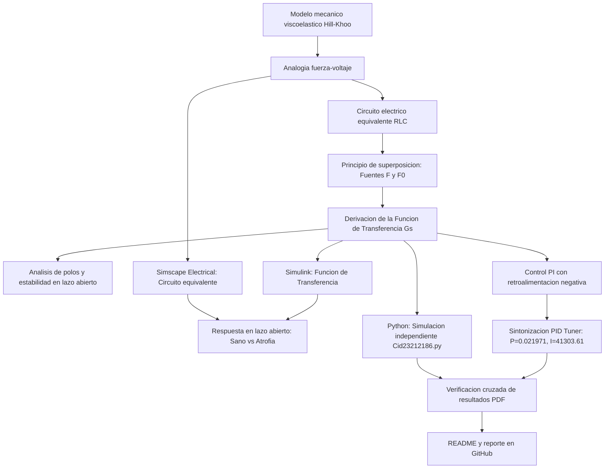

# Práctica — Modelado y control del sistema musculoesquelético

Repositorio académico de la asignatura **Modelado de Sistemas Fisiológicos**, correspondiente al programa de **Ingeniería Biomédica** del Tecnológico Nacional de México / Instituto Tecnológico de Tijuana. Esta práctica integra el modelado mecánico de tejidos viscoelásticos, analogías electromecánicas fuerza-voltaje, análisis temporal y de estabilidad, diseño de un **controlador PI** en lazo cerrado, simulación computacional *in silico* y verificación cruzada.

**Docente:** Dr. Paul Antonio Valle Trujillo  
**Correo:** paul.valle@tectijuana.edu.mx  
**Departamento:** Ingeniería Eléctrica y Electrónica  
**Institución:** Tecnológico Nacional de México / Instituto Tecnológico de Tijuana  
**Asignatura:** Modelado de Sistemas Fisiológicos  
**Programa:** Ingeniería Biomédica  
**Estudiante:** Christian Cid Pacheco · 23212186 · l23212186@tectijuana.edu.mx  

**Repositorio de la asignatura:** https://github.com/DrPaulValle/MSF-IBF1020  
**Sede:** Blvd. Alberto Limón Padilla s/n, Tijuana, C. P. 22454, B. C., México.

---

<a id="contenido"></a>
## Contenido

1. [Resumen](#resumen)
2. [Competencia y objetivos](#objetivos)
3. [Relación con el temario](#temario)
4. [Modelo físico y analogía electromecánica](#analogia)
5. [Análisis matemático por superposición](#modelo)
6. [Análisis temporal y de estabilidad](#analisis)
7. [Señales de entrada y condiciones de simulación](#senales)
8. [Implementación en MATLAB, Simulink y Simscape](#matlab)
9. [Control en lazo cerrado y sintonización PI](#pid)
10. [Reproducción en Python](#python)
11. [Resultados y verificación cruzada](#resultados)
12. [Diagrama biológico](#diagrama-biologico)
13. [Flujo de trabajo](#flujo)
14. [Actividades del estudiante](#actividades)
15. [Estructura del repositorio](#estructura)
16. [Requisitos](#requisitos)
17. [Reproducibilidad y entregables](#reproducibilidad)
18. [Referencias](#referencias)

---

<a id="resumen"></a>
## Resumen

La práctica tiene como propósito **analizar, simular y controlar un modelo mecánico del sistema musculoesquelético** empleando herramientas computacionales y técnicas de control clásico. Las propiedades viscoelásticas del tejido muscular y tendinoso se describen mediante una combinación de elemento contráctil activo ($F_0$), elemento elástico en serie ($C_s$), elemento elástico en paralelo ($C_p$) y amortiguador viscoso ($R$). A partir de la **analogía fuerza-voltaje**, este sistema mecánico se convierte en su circuito eléctrico equivalente.

Se derivan las ecuaciones diferenciales y la función de transferencia del sistema mediante el **principio de superposición** (considerando las fuentes independientes $F(t)$ y $F_0(t)$ para evaluar la respuesta dinámica. Se contrastan dos condiciones: un **individuo sano (control, $R = 100\,\Omega$)** y un paciente con **atrofia muscular (caso, $R = 10\,\mathrm{k}\Omega$)**. Posteriormente, se incorpora un **controlador PI en lazo cerrado** actuando sobre el caso atrófico, tomando como referencia la respuesta del individuo sano. Todos los resultados se simulan *in silico* y se verifican de forma cruzada en MATLAB/Simulink, Simscape Electrical y Python.

**Palabras clave:** sistema musculoesquelético; atrofia muscular; analogía fuerza-voltaje; viscoelasticidad; controlador PI; MATLAB; Simulink; Simscape Electrical; Python; simulación *in silico*.

[Volver al contenido](#contenido)

---

<a id="objetivos"></a>
## Competencia y objetivos

### Competencia a desarrollar

Modelizar sistemas fisiológicos mediante analogías entre sistemas físicos, ecuaciones diferenciales y funciones de transferencia para analizar su comportamiento dinámico y diseñar estrategias de control mediante técnicas de control clásico. En particular, analizar un modelo mecánico simplificado del sistema musculoesquelético, construir su circuito eléctrico equivalente mediante la analogía fuerza-voltaje, comparar la respuesta de un individuo sano con un caso de atrofia muscular, y diseñar un control PI *in silico*.

### Objetivo general

Formular el modelo matemático y el circuito equivalente de un compartimento musculoesquelético viscoelástico, simular su respuesta temporal ante una fuerza aplicada en condiciones de salud y patología (atrofia muscular), y diseñar un sistema de control PI en lazo cerrado *in silico* que aproxime la dinámica del paciente a la de la referencia sana.

### Objetivos específicos

- Identificar los componentes mecánicos del músculo y sus variables asociadas mediante el diagrama biológico.
- Construir el circuito eléctrico equivalente aplicando rigurosamente la analogía fuerza-voltaje.
- Derivar la función de transferencia $G(s)$ aplicando el **principio de superposición** debido a la presencia de múltiples fuentes ($F(t)$ y $F_0(t)$).
- Determinar la localización de los polos y la estabilidad en lazo abierto.
- Simular la respuesta al impulso y escalón mediante MATLAB, Simulink, Simscape Electrical y Python.
- Diseñar y sintonizar un **controlador PI** utilizando la herramienta `PID Tuner` de Simulink para minimizar la señal de error $e(t) = x_{\mathrm{control}}(t) - x_{\mathrm{caso}}(t)$.
- Elaborar un diagrama biológico en BioRender que vincule las estructuras anatómicas musculares con las propiedades mecánicas y eléctricas.
- Documentar el código, archivos de simulación, figuras y resultados en un repositorio académico en GitHub.

[Volver al contenido](#contenido)

---

<a id="temario"></a>
## Relación con el temario

La práctica integra contenidos correspondientes a tres unidades de la asignatura **Modelado de Sistemas Fisiológicos (IBF-1020)**:

| Unidad | Área | Contenidos aplicados |
|---|---|---|
| I | Sistemas de control retroalimentados | Diagramas de bloques, retroalimentación negativa, respuesta temporal, análisis de error y criterios de estabilidad |
| II | Modelado matemático | Analogía mecánica (fuerza-voltaje), modelado musculoesquelético, transformadas de Laplace y funciones de transferencia |
| III | Controladores | Modos de control P e I, diseño de controladores PI y sintonización de ganancias en lazo cerrado |

[Volver al contenido](#contenido)

---

<a id="analogia"></a>
## Modelo físico y analogía electromecánica

El compartimento musculoesquelético se describe mediante el modelo de Hill-Khoo. La fuerza contráctil activa $F_0(t) = \alpha F(t)$ ($\alpha = 0.25$) opera en paralelo con la amortiguación viscosa del tejido $R$. En serie se encuentra la elasticidad tendinosa $C_s$, mientras que la elasticidad pasiva muscular se representa mediante el elemento $C_p$.

| Sistema mecánico | Variable / Elemento | Sistema eléctrico equivalente | Interpretación fisiológica |
|---|---|---|---|
| Fuerza $F(t)$ | Variable de entrada | Voltaje $V(t)$ | Fuerza total transmitida por el compartimento |
| Desplazamiento $x(t)$ | Variable de salida | Carga eléctrica $q(t)$ | Elongación / acortamiento muscular total |
| Amortiguador | $R$ | Resistencia $R$ | Fricción viscosa interna y resistencia pasiva |
| Compliancia mecánica | $C_s, C_p$ | Capacitancia $C_s, C_p$ | Elasticidad del tendón ($C_s$) y estructuras pasivas ($C_p$) |

### Parámetros para la simulación *in silico*

| Parámetro | Control (Sano) | Caso (Atrofia) | Unidad eléctrica | Interpretación biomecánica |
|---|---:|---:|---|---|
| $F(t)$ | $1$ | $1$ | $\mathrm{V}$ | Entrada de fuerza aplicada ($1\,\mathrm{N}$) |
| $\alpha$ | $0.25$ | $0.25$ | Adimensional | Factor de ganancia contráctil activa |
| $C_s$ | $10\times10^{-6}$ | $10\times10^{-6}$ | $\mathrm{F}$ ($10\,\mu\mathrm{F}$) | Compliancia elástica en serie (Tendón) |
| $C_p$ | $100\times10^{-6}$ | $100\times10^{-6}$ | $\mathrm{F}$ ($100\,\mu\mathrm{F}$) | Compliancia elástica en paralelo |
| $R$ | $100$ | $10\,000$ | $\Omega$ ($100\,\Omega$ / $10\,\mathrm{k}\Omega$) | Amortiguamiento viscoso tisular |

[Volver al contenido](#contenido)

---

<a id="modelo"></a>
## Análisis matemático por superposición

Debido a que el circuito equivalente del sistema cuenta con dos fuentes de voltaje ($F(t)$ y $F_0(t)$), se aplica el **principio de superposición** para determinar la respuesta global:

### 1. Circuito 1: Apagando $F_0(t)$ (Análisis ante $F(t)$)

Desactivando la fuente $F_0(t)$ y analizando las relaciones de corriente y desplazamiento en los nodos del circuito equivalente:

$$x(t) = x_1(t) + x_2(t)$$

$$x(t) = C_p \frac{d F_s(t)}{dt} = C_s \frac{d[F(t) - F_s(t)]}{dt}$$

$$i(t) = \frac{F(t) - F_s(t)}{R}$$

Aplicando la transformada de Laplace con condiciones iniciales nulas:

$$C_p s F_s(s) = C_s s [F(s) - F_s(s)] + \frac{F(s) - F_s(s)}{R}$$

Agrupando términos semejantes para despejar $F_{s1}(s)$:

$$F_s(s) \left( C_p s + C_s s + \frac{1}{R} \right) = \left( C_s s + \frac{1}{R} \right) F(s)$$

$$F_{s1}(s) = \frac{R C_s s + 1}{R(C_p + C_s)s + 1} F(s)$$

### 2. Circuito 2: Apagando $F(t)$ (Análisis ante $F_0(t) = \alpha F(t)$)

Desactivando la fuente $F(t)$ y considerando la acción de la fuerza contráctil activa $-\alpha F(t)$:

$$-\alpha F(t) = R \dot{x}(t) + \frac{1}{C_p + C_s} \int x(t) dt$$

$$F_{s2}(s) = \frac{X(s)}{(C_p + C_s)s}$$

$$F(s) = -\frac{1}{\alpha} \left( R + \frac{1}{(C_p + C_s)s} \right) X(s) = -\frac{1}{\alpha} \frac{R(C_p + C_s)s + 1}{(C_p + C_s)s} X(s)$$

Relacionando la salida $F_{s2}(s)$ con la entrada $F(s)$:

$$F_{s2}(s) = \frac{-\alpha}{R(C_p + C_s)s + 1} F(s)$$

### 3. Función de transferencia global

Sumando las contribuciones parciales mediante superposición ($F_s(s) = F_{s1}(s) + F_{s2}(s)$):

$$F_s(s) = \frac{R C_s s + 1}{R(C_p + C_s)s + 1} F(s) - \frac{\alpha}{R(C_p + C_s)s + 1} F(s)$$

$$\boxed{G(s) = \frac{X(s)}{F(s)} = \frac{R C_s s + 1 - \alpha}{R(C_p + C_s)s + 1}}$$

Sustituyendo el valor del factor contráctil $\alpha = 0.25$:

$$G(s) = \frac{R C_s s + 0.75}{R(C_p + C_s)s + 1}$$

[Volver al contenido](#contenido)

---

<a id="analisis"></a>
## Análisis temporal y de estabilidad

### Polos y estabilidad en lazo abierto

Para determinar la estabilidad, se iguala a cero el denominador de la función de transferencia:

$$R(C_p + C_s)s + 1 = 0 \implies \lambda = -\frac{1}{R(C_p + C_s)}$$

- Dado que $R > 0$, $C_p > 0$ y $C_s > 0$, el polo $\lambda$ se encuentra en el semiplano izquierdo del plano complejo ($\lambda < 0$), lo que confirma que **el sistema en lazo abierto es strictly estable**.
- Para el individuo sano ($R = 100\,\Omega$), $\lambda = -909.09\,\mathrm{rad/s}$ (respuesta rápida).
- Para el caso con atrofia ($R = 10\,\mathrm{k}\Omega$), $\lambda = -9.09\,\mathrm{rad/s}$ (respuesta amortiguada y lenta).

[Volver al contenido](#contenido)

---

<a id="senales"></a>
## Señales de entrada y condiciones de simulación

El intervalo nominal de simulación es $0 \le t \le 10\,\mathrm{s}$ con un paso de integración $\Delta t = 10^{-3}\,\mathrm{s}$, evaluando la respuesta ante pulsos y escalones de fuerza.

[Volver al contenido](#contenido)

---

<a id="matlab"></a>
## Implementación en MATLAB, Simulink y Simscape

La simulación se ejecuta desde el *Live Script* `Cid_23212186.mlx`, cargando el modelo de Simulink `sistema.slx` y generando automáticamente los resultados gráficos en formato vectorial (`.pdf`).

Se comparan tres representaciones computacionales equivalentes:

| Implementación | Descripción | Aspecto por verificar |
|---|---|---|
| Ecuaciones diferenciales, Simulink | Bloques de suma, ganancias e integradores | Consistencia con el equilibrio mecánico |
| Función de transferencia, Simulink | Bloque $G(s) = X(s)/F(s)$ | Respuesta dinámico-frecuencial del modelo |
| Circuito equivalente, Simscape Electrical | Red de componentes $R$, $C_s$, $C_p$ y fuente $V(t)$ | Concordancia entre el dominio eléctrico y el mecánico |

### Ejecución desde el cuaderno MATLAB

El cuaderno `.mlx` ejecuta el modelo de Simulink e extrae las señales al *Workspace*:
1. **Entrada de Fuerza:** $F(t)$.
2. **Salida Control (Sano):** $x_{\mathrm{control}}(t)$.
3. **Salida Caso (Atrofia):** $x_{\mathrm{caso}}(t)$.
4. **Salida Caso Controlado (PID):** $x_{\mathrm{PID}}(t)$.

[Volver al contenido](#contenido)

---

<a id="pid"></a>
## Control en lazo cerrado y sintonización PI

Para corregir la dinámica del caso con atrofia muscular respecto al individuo sano, se implementó un **controlador PI (Proporcional-Integral)** en lazo cerrado.

$$e(t) = x_{\mathrm{control}}(t) - x_{\mathrm{caso}}(t)$$

### Parámetros del controlador PI sintonizado (`PID Tuner` de Simulink)

| Parámetro / Métrica | Valor sintonizado |
|---|---|
| **Tipo de controlador** | **PI** |
| **Ganancia Proporcional ($P$)** | `0.021971` |
| **Ganancia Integral ($I$)** | `41303.6113` |
| **Ganancia Derivativa ($D$)** | `n/a` |
| **Tiempo de subida (Rise time)** | `0.000583 s` |
| **Tiempo de establecimiento (Settling time)** | `0.00102 s` |
| **Sobremecimiento (Overshoot)** | `0.108 %` |
| **Estabilidad en lazo cerrado** | **Estable** |

[Volver al contenido](#contenido)

---

<a id="python"></a>
## Reproducción en Python

El script `Cid23212186.py` reproduce de manera independiente la simulación mediante las librerías `control`, `scipy.signal`, `numpy` y `matplotlib`, validando la función de transferencia y la acción del controlador PI.

1. Definición del vector de tiempo $t \in [0, 10]\,\mathrm{s}$.
2. Definición de las funciones de transferencia $G_{\mathrm{control}}(s)$ y $G_{\mathrm{caso}}(s)$.
3. Cálculo de la respuesta al impulso (`scipy.signal.impulse`).
4. Construcción del sistema en lazo cerrado con el controlador PID.
5. Generación y exportación de figuras en formato PDF.

[Volver al contenido](#contenido)

---

<a id="resultados"></a>
## Resultados y verificación cruzada

Convención de colores en las gráficas:
- **Azul oscuro ($F(t)$):** Entrada de fuerza aplicada.
- **Azul claro ($F(t)$: Control):** Respuesta del individuo sano ($R = 100\,\Omega$).
- **Gris / Morado ($F(t)$: Caso):** Respuesta del caso con atrofia muscular en lazo abierto ($R = 10\,\mathrm{k}\Omega$).
- **Verde ($PI(t)$: Tratamiento):** Respuesta del caso atrófico regulado mediante el controlador PI en lazo cerrado.

[Volver al contenido](#contenido)

---

<a id="diagrama-biologico"></a>
## Diagrama biológico

El diagrama biológico elaborado en BioRender establece la equivalencia directa entre las estructuras anatómicas y los parámetros del modelo mecánico:

- **$F_0$ (Elemento contráctil):** Fuerza activa generada por los sarcómeros.
- **$C_s$ (Tendón):** Elementos elásticos en serie.
- **$C_p$ (Estructuras elásticas musculares):** Sarcolema, epimisio, perimisio y endomisio.
- **$R$ (Elemento viscoso):** Fricción tisular ($R = 100\,\Omega$ en sano vs. $R = 10\,\mathrm{k}\Omega$ en atrofia).


[Volver al contenido](#contenido)

---

<a id="flujo"></a>
## Flujo de trabajo



[Volver al contenido](#contenido)

---

<a id="actividades"></a>
## Actividades del estudiante

- [x] Identificar los componentes mecánicos del músculo e ilustrarlos en el diagrama biológico.
- [x] Derivar la función de transferencia $G(s)$ aplicando el principio de superposición.
- [x] Determinar la posición del polo y analizar la estabilidad en lazo abierto.
- [x] Implementar los modelos en MATLAB/Simulink y Simscape Electrical.
- [x] Diseñar y sintonizar el **controlador PI** con `PID Tuner` de Simulink.
- [x] Reproducir la simulación completa en Python con el script `Cid23212186.py`.
- [x] Documentar el reporte final en el repositorio de GitHub.

[Volver al contenido](#contenido)

---

<a id="estructura"></a>
## Estructura del repositorio

```text
.
├── README.md                      # Reporte y guía de reproducción
├── Cid_23212186.mlx               # Cuaderno MATLAB del estudiante
├── Cid_23212186.pdf               # Exportación del cuaderno en PDF
├── Cid23212186.py                 # Script de simulación en Python con control PI
├── modelo_musculoesqueletico.slx  # Modelo Simulink/Simscape del sistema
├── Diagrama biologico.png         # Esquema biológico de BioRender
└── Analisis matematico.pdf        # Demostración matemática por superposición
```

[Volver al contenido](#contenido)

---

<a id="requisitos"></a>
## Requisitos

- **MATLAB** (R2023b o superior) con Control System Toolbox.
- **Simulink** y **Simscape Electrical**.
- **Python 3.10+** con las librerías `numpy`, `scipy`, `matplotlib` y `control`.

[Volver al contenido](#contenido)

---

<a id="reproducibilidad"></a>
## Reproducibilidad y entregables

1. Clonar el repositorio.
2. Abrir y ejecutar `Cid_23212186.mlx` en MATLAB para compilar los modelos de Simulink.
3. Ejecutar el script `Cid23212186.py` en Python para corroborar las respuestas gráficas.

[Volver al contenido](#contenido)

---

<a id="referencias"></a>
## Referencias

[1] M. C. Khoo, *Physiological Control Systems: Analysis, Simulation, and Estimation*, 2nd ed., IEEE Press, 2018.

[2] K. Ogata, *Ingeniería de Control Moderna*, 5.ª ed., Pearson Educación, 2010.

[3] P. A. Valle, *Syllabus para Modelado de Sistemas Fisiológicos*, Tecnológico Nacional de México / Instituto Tecnológico de Tijuana, Tijuana, B. C., México, 2026.

---

## Uso académico

Este repositorio se utiliza como evidencia de una práctica introductoria de **Modelado de Sistemas Fisiológicos**. El procedimiento se fundamenta en materiales y resultados de referencia proporcionados por la asignatura. Su finalidad es desarrollar habilidades de interpretación, reproducción computacional, verificación experimental y documentación técnica; cualquier cambio de parámetros, estructura del controlador o procedimiento debe identificarse y justificarse.
